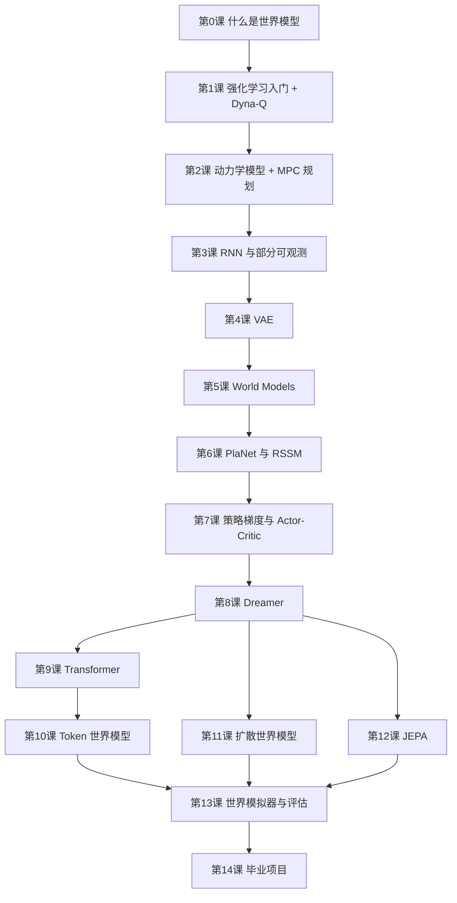

# WM基础：世界模型从零到一

一个深度学习初学者系统学习**世界模型（World Models）**的课程仓库。

- **适合谁**：会用 PyTorch 训练 CNN（学过 d2l 前 7 章），RNN、Transformer、VAE、强化学习都还没学过也没关系，用到时课程里会补。
- **每一课包括**：
  - 中文讲义（`README.md`）
  - 已经跑过、带输出的 notebook（在 GitHub 上直接能看结果）
  - 课后练习
- **算力**：每课的默认配置在普通 CPU 上几分钟就能跑完；需要大算力的实验会另给一份 GPU 配置。

## 怎么学

1. 读这一课讲义的前几节
2. 打开 notebook，从上到下运行
3. 读完讲义剩下的部分，做练习（改 notebook 开头配置格子里的参数就行）
4. 有问题随时问 Claude

## 在自己电脑上运行

```bash
git clone https://github.com/XDU-jnLi/WM-basics.git    # 仓库改名前叫 deeplearning
cd WM-basics
git checkout claude/claude-cloud-intro-cm9pxa           # 合并到 main 之前，课程在这个分支上
pip install -r requirements.txt                         # 故意没写 torch，见文件里的说明
jupyter notebook
```

打开 notebook 后，把 kernel 切换成你装了 PyTorch 的那个环境（比如你的 `DeepLearning` kernel）。代码兼容 Python 3.9 及以上，有 GPU 会自动使用，没有就用 CPU。

## 课程路线图

主线是强化学习中的世界模型（第 0–8 课），之后扩展到 Transformer、扩散、JEPA 三条前沿路线。



所有课程共用一个玩具世界 **BallWorld**（盒子里的小球），每课只把它升级一点：
- 能看到完整状态（第 0 课）
- 只能看到位置（第 3 课）
- 只能看到像素（第 4 课）
- 带奖励的像素小游戏（第 5 课起）

每课都用同一张"世界模型成绩单"评价模型，包括四项：单步误差、多步误差、控制效果、会不会被钻空子。

| 课 | 主题 | 顺便补的基础 | 状态 |
|---|---|---|---|
| [第 0 课](lesson00_intro/) | 什么是世界模型：弹球世界 + MLP 世界模型 + 做梦 + 规划 | 只用已经会的 MLP | ✅ 已完成 |
| 第 1 课 | 强化学习入门 + Dyna-Q（最早的"在想象中学习"） | MDP、Q-learning | 待更新 |
| 第 2 课 | 学动力学模型 + MPC 规划（CEM、高斯 NLL、集成） | 概率基础 | 待更新 |
| 第 3 课 | RNN/GRU：记忆与部分可观测 | 序列模型 | 待更新 |
| 第 4 课 | 自编码器 → VAE：把图像压成潜变量 | KL 散度、ELBO | 待更新 |
| 第 5 课 | Ha & Schmidhuber World Models：在梦里训练控制器 | 混合密度网络 | 待更新 |
| 第 6 课 | PlaNet 的 RSSM：潜空间动力学 + 潜空间规划 | | 待更新 |
| 第 7 课 | 策略梯度 → Actor-Critic | Dreamer 要用的 RL | 待更新 |
| 第 8 课 | Dreamer：在想象中训练策略（v1 → v3） | | 待更新 |
| 第 9 课 | 注意力与 Transformer | Transformer | 待更新 |
| 第 10 课 | VQ-VAE、IRIS、Genie 的潜在动作模型 | | 待更新 |
| 第 11 课 | 扩散模型 → DIAMOND、GameNGen | 扩散模型 | 待更新 |
| 第 12 课 | JEPA：在表征空间里预测 | | 待更新 |
| 第 13 课 | 世界模拟器（Sora、Genie 3、Cosmos）与如何评估世界模型 | | 待更新 |
| 第 14 课 | 毕业项目：做一个"能玩"的 BallWorld 世界模型 | | 待更新 |

## 我的进度

学完一课就在这里打个勾（在 GitHub 上编辑这个文件，把 `[ ]` 改成 `[x]`）：

- [ ] 第 0 课 什么是世界模型
- [ ] 第 1 课 强化学习入门 + Dyna-Q
- [ ] 第 2 课 动力学模型 + MPC 规划
- [ ] 第 3 课 RNN 与部分可观测
- [ ] 第 4 课 VAE
- [ ] 第 5 课 World Models
- [ ] 第 6 课 PlaNet 与 RSSM
- [ ] 第 7 课 策略梯度与 Actor-Critic
- [ ] 第 8 课 Dreamer
- [ ] 第 9 课 Transformer
- [ ] 第 10 课 Token 世界模型
- [ ] 第 11 课 扩散世界模型
- [ ] 第 12 课 JEPA
- [ ] 第 13 课 世界模拟器与评估
- [ ] 第 14 课 毕业项目

## 配合阅读

**《动手学深度学习》中文第二版**（[zh.d2l.ai](https://zh.d2l.ai/)）：

| 本课程 | 对应的 d2l 章节 |
|---|---|
| 第 3 课 RNN | 第 8 章 循环神经网络；第 9 章 现代循环神经网络（9.1 GRU） |
| 第 9 课 Transformer | 第 10 章 注意力机制 |
| 所有课 | 第 11 章 优化算法（11.10 Adam） |

**强化学习**：
- Sutton & Barto《强化学习（第 2 版）》，第 8 章"规划与学习"和第 1、2 课关系最紧
- [Datawhale 蘑菇书 easy-rl](https://github.com/datawhalechina/easy-rl)：中文强化学习入门教程

## 论文清单

不用现在读，学到对应的课再看。

| 课 | 论文 |
|---|---|
| 第 2 课 | [PETS](https://arxiv.org/abs/1805.12114)（2018）、[MBPO](https://arxiv.org/abs/1906.08253)（2019） |
| 第 5 课 | [World Models](https://arxiv.org/abs/1803.10122)（2018），交互式网页版：[worldmodels.github.io](https://worldmodels.github.io/) |
| 第 6 课 | [PlaNet](https://arxiv.org/abs/1811.04551)（2018） |
| 第 8 课 | [Dreamer](https://arxiv.org/abs/1912.01603)（2019）、[DreamerV2](https://arxiv.org/abs/2010.02193)（2020）、[DreamerV3](https://arxiv.org/abs/2301.04104)（2023） |
| 第 10 课 | [IRIS](https://arxiv.org/abs/2209.00588)（2022）、[Genie](https://arxiv.org/abs/2402.15391)（2024） |
| 第 11 课 | [DIAMOND](https://arxiv.org/abs/2405.12399)（2024）、[GameNGen](https://arxiv.org/abs/2408.14837)（2024） |
| 第 12 课 | [I-JEPA](https://arxiv.org/abs/2301.08243)（2023）、[V-JEPA](https://arxiv.org/abs/2404.08471)（2024）、[V-JEPA 2](https://arxiv.org/abs/2506.09985)（2025）、[DINO-WM](https://arxiv.org/abs/2411.04983)（2024） |
| 第 13 课 | [Cosmos](https://arxiv.org/abs/2501.03575)（2025）、[MuZero](https://arxiv.org/abs/1911.08265)（2019）、[TD-MPC2](https://arxiv.org/abs/2310.16828)（2023） |

## 目录结构

```
README.md          课程路线图（本文件）
requirements.txt   依赖（不含 torch）
lesson00_intro/    第 0 课：讲义 README.md + notebook
d2l_practice/      之前跟着 d2l 做的 GoogLeNet 练习
```

## 维护说明

- notebook 是唯一的源文件。
- 修改之后重新执行、保存输出：

  ```bash
  jupyter nbconvert --to notebook --execute --inplace lesson00_intro/lesson00_intro.ipynb
  ```

- 讲义里的结论都按定性来写（比如"碰墙处误差明显更大"），具体数字以 notebook 输出为准。在不同机器和版本上，具体数字会有小差异。
